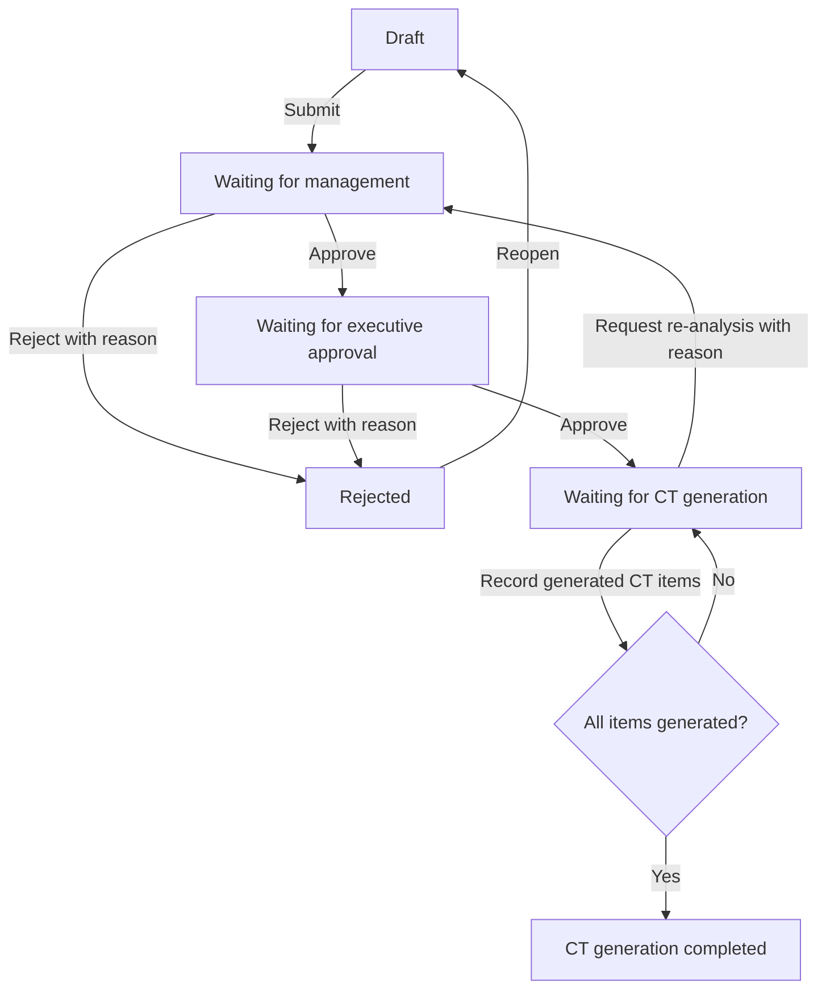
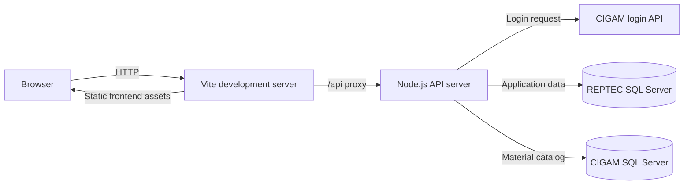

# CT Request and Inventory Replenishment

[](https://github.com/Cleristonl1m4/request_ct/actions/workflows/ci.yml)

Web application for requesting, reviewing, and approving inventory replenishment. It validates materials against the CIGAM catalog, supports management and executive approval stages, and records CT generation performed in the external ERP system.

> **Status:** Active development. Business rules that are not represented in the current implementation still require confirmation.

## Table of Contents

- [Overview](#overview)
- [Features](#features)
- [System Flow](#system-flow)
- [Architecture](#architecture)
- [Technology Stack](#technology-stack)
- [Prerequisites](#prerequisites)
- [Installation](#installation)
- [Configuration](#configuration)
- [Running the Application](#running-the-application)
- [API and Integrations](#api-and-integrations)
- [Database and Migrations](#database-and-migrations)
- [Validation and Tests](#validation-and-tests)
- [Project Structure](#project-structure)
- [Contribution](#contribution)
- [Security](#security)
- [License](#license)
- [Additional Documentation](#additional-documentation)

## Overview

The application manages a replenishment request from draft to completion:

1. A requester creates a draft and adds one or more materials.
2. The backend validates and stores the request in SQL Server.
3. Management reviews the request and may adjust quantities.
4. Executive approval authorizes the request for CT generation.
5. A CT operator records which items were generated in the external system.
6. The request history remains available for audit and follow-up.

The application does **not** create CTs automatically. It records the result of the manual operation performed in the external ERP system.

## Features

Implemented capabilities:

- Create, edit, save, submit, and delete draft requests.
- Search the CIGAM material catalog by material code.
- Select material specifications and numbering options.
- Filter requests by workflow status.
- Review, adjust, approve, reject, and reopen requests.
- Request re-analysis with a mandatory reason.
- Record CT numbers and generated items, including partial processing.
- Display request items, approval decisions, and workflow status.
- Manage user roles and active permissions.
- Store request history and workflow actions for auditability.

Current limitations:

- No automated unit, integration, or end-to-end test suite is defined in `package.json`.
- No production deployment procedure is defined in this repository.
- The external CIGAM login API and SQL Server databases must be available at runtime.
- CT creation remains an external manual operation.

## System Flow

### Request lifecycle



The transitions are enforced by the backend in `server.mjs`. Approval permissions are checked against the authenticated user's level before each transition.

### Runtime architecture



In development, Vite proxies `/api` requests to `http://localhost:8787`. The browser does not connect directly to SQL Server or to the CIGAM login API.

## Architecture

| Component | Responsibility |
| --- | --- |
| React frontend | Authentication screens, request workflow, dashboards, and permission management |
| `server.mjs` | HTTP API, session handling, authorization, workflow transitions, and SQL access |
| REPTEC SQL Server | Users, permissions, requests, items, and audit history |
| CIGAM SQL Server | Material catalog lookup through existing ERP tables |
| CIGAM login API | External credential validation |

Authentication creates an HTTP-only `reptec_session` cookie. The backend keeps the session in memory, so a process restart invalidates active sessions and multiple API instances require a shared session design that is not currently implemented.

## Technology Stack

- TypeScript 5.5 and React 18.
- Vite 7 and `@vitejs/plugin-react`.
- Tailwind CSS 3.
- Node.js HTTP server using ECMAScript modules.
- `mssql` 12 for Microsoft SQL Server access.
- ESLint 9 with TypeScript and React plugins.
- npm with a committed `package-lock.json`.

The GitHub Actions workflow currently validates the project with Node.js 20.

## Prerequisites

- Node.js 20 or a compatible newer Node.js release. The CI workflow uses Node.js 20.
- npm, installed with Node.js.
- Network access to the configured CIGAM login API.
- Network access and credentials for the REPTEC and CIGAM SQL Server databases.
- Permission to apply the SQL Server schema and migrations in the target development database.

## Installation

```bash
cd request_ct
npm ci
```

Prepare the database and environment before starting the API:

1. Apply `sqlserver/schema.sql` to the application database.
2. Apply `sqlserver/migrations/001_ct_partial_processing.sql`.
3. Apply `sqlserver/migrations/002_material_text_size.sql`.
4. Apply `sqlserver/migrations/003_request_number.sql`.
5. Copy `.env.example` to `.env`.
6. Fill in the required environment values described below.

Do not apply database scripts to production without an authorized change process, backup strategy, and rollback assessment.

## Configuration

Create a local environment file:

```bash
cp .env.example .env
```

On Windows PowerShell, use:

```powershell
Copy-Item .env.example .env
```

Configure the variables as follows:

| Variable | Required | Description | Example |
| --- | --- | --- | --- |
| `LOGIN_API_URL` | No | External CIGAM login endpoint. The server has a built-in default when omitted. | `https://example.invalid/login` |
| `API_PORT` | No | Port used by the Node.js API. | `8787` |
| `SQL_SERVER` | Yes | SQL Server host or address. | `<SQL_SERVER_HOST>` |
| `SQL_PORT` | No | SQL Server port. | `1433` |
| `SQL_DATABASE` | Yes | Database checked by the server startup validation. | `REPTEC` |
| `SQL_REPTEC_DATABASE` | No | Database used for application data. Defaults to `REPTEC` when omitted. | `REPTEC` |
| `SQL_CIGAM_DATABASE` | No | Database used for the material catalog. Defaults to `CIGAM` when omitted. | `CIGAM` |
| `SQL_USER` | Yes | SQL Server login. | `<SQL_USER>` |
| `SQL_PASSWORD` | Yes | SQL Server password. | `<SQL_PASSWORD>` |
| `SQL_ENCRYPT` | No | Enables SQL connection encryption unless explicitly set to `false`. | `false` |
| `SQL_TRUST_SERVER_CERTIFICATE` | No | Trusts the SQL Server certificate when set to `true`. | `true` |

`SQL_DATABASE` is required by the current startup guard in `server.mjs`, even when `SQL_REPTEC_DATABASE` is also configured. Never commit `.env`, passwords, tokens, or private keys.

## Running the Application

Start the API in one terminal:

```bash
npm run dev:api
```

Start the Vite frontend in a second terminal:

```bash
npm run dev
```

Open the URL printed by Vite, normally `http://localhost:5173`. The API listens on `http://localhost:8787` by default, and Vite proxies frontend `/api` requests to it.

To preview a production frontend build locally:

```bash
npm run build
npm run preview
```

The repository does not define a production process manager, container image, hosting platform, or deployment script.

## API and Integrations

The API is served by `server.mjs` under the `/api` path. Protected endpoints require the HTTP-only session cookie created by login.

| Method | Endpoint | Purpose |
| --- | --- | --- |
| `POST` | `/api/login` | Authenticate through the CIGAM login API and create a session |
| `GET` | `/api/auth/session` | Read the current session |
| `POST` | `/api/auth/logout` | End the current session |
| `GET` | `/api/requisicoes?filter=minhas\|fila\|todas` | List requests visible to the current user |
| `POST` | `/api/requisicoes` | Create a request draft |
| `GET` | `/api/requisicoes/:id` | Read a request and its items |
| `DELETE` | `/api/requisicoes/:id` | Delete a draft request |
| `POST` | `/api/requisicoes/:id/itens` | Add an item to a request |
| `PATCH` | `/api/itens/:id` | Update a draft item |
| `DELETE` | `/api/itens/:id` | Delete a draft item |
| `POST` | `/api/itens/:id/aprovacao` | Save an approval decision and optional turnover value |
| `GET` | `/api/requisicoes/:id/historico` | Read request history |
| `POST` | `/api/requisicoes/:id/transicao` | Execute a workflow transition |
| `GET` | `/api/permissoes` | List user permissions |
| `PUT` | `/api/permissoes` | Create or update a permission record |
| `POST` | `/api/permissoes/:codigo/ativo` | Enable or disable a permission |
| `GET` | `/api/materiais?codigo=<code>` | Query the CIGAM material catalog |

The API returns JSON and uses an `error` property for application errors. There is no OpenAPI specification in the repository yet.

## Database and Migrations

The active backend uses Microsoft SQL Server. `sqlserver/schema.sql` creates the application tables:

- `permissoes_usuario`: user roles and access state.
- `requisicoes`: request header, status, company, and CT information.
- `requisicao_itens`: requested and approved materials, turnover, and CT state.
- `requisicao_historico`: workflow actions and audit records.

The material catalog remains in existing CIGAM ERP tables, queried by the API from `ESMATERI` and `ESESTOQU`. Apply schema and migrations in filename order. Review each SQL change before using it against shared or production data.

## Validation and Tests

Run the checks available in the repository:

```bash
npm run lint
npm run typecheck
npm run build
```

The GitHub Actions workflow runs the same commands on pushes to `main` and on pull requests. There are currently no automated unit, integration, contract, or end-to-end test scripts in `package.json`. The existing lint run reports one non-blocking Fast Refresh warning in `src/context/AuthContext.tsx`.

## Project Structure

```text
request_ct/
├── .github/workflows/ci.yml       # GitHub Actions validation
├── docs/GIT_WORKFLOW.md           # Branch, commit, and PR governance
├── sqlserver/                     # Application schema and SQL Server migrations
├── supabase/migrations/           # Existing Supabase migration artifact
├── src/
│   ├── components/                # Login, shell, dashboard, request, and permission views
│   ├── context/                   # Authentication state and session actions
│   └── lib/                       # API client, domain types, and display constants
├── .env.example                   # Safe environment template
├── server.mjs                     # Node.js API server
├── package.json                   # Scripts and dependencies
├── vite.config.ts                 # Vite aliases and API proxy
└── README.md                      # Project entry point
```

## Contribution

Use the workflow documented in [`docs/GIT_WORKFLOW.md`](docs/GIT_WORKFLOW.md):

1. Create a short-lived branch from `main`, such as `feature/123-add-material-filter`.
2. Make one coherent change at a time.
3. Use Conventional Commits, for example `feat(requests): add material filter`.
4. Run lint, typecheck, and build locally.
5. Open a Pull Request describing the objective, risks, database changes, validation results, and rollback considerations.

Do not push directly to `main`. Review the current repository settings before relying on branch protection or required approvals.

## Security

- Keep `.env` and all credentials outside version control.
- Use placeholders in documentation and examples.
- Rotate credentials that may have been exposed.
- Do not log passwords, session tokens, or sensitive database responses.
- Keep authentication and authorization decisions in the backend.
- Use HTTPS for deployed environments.
- Review SQL migrations before applying them to shared or production databases.
- Report suspected vulnerabilities privately to the project maintainers; do not publish exploit details in an issue.

## License

No license file or explicit license declaration is currently present. Licensing must be confirmed by the project owners before redistribution.

## Additional Documentation

- [Git workflow and repository governance](docs/GIT_WORKFLOW.md)
- [CI workflow](.github/workflows/ci.yml)
- [SQL Server schema](sqlserver/schema.sql)
- [SQL Server migrations](sqlserver/migrations/)
- [GitHub repository](https://github.com/Cleristonl1m4/request_ct)
